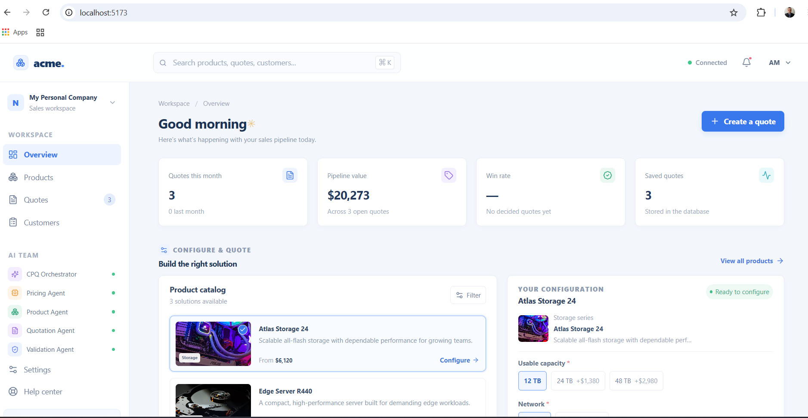

# My Personal Company Configure & Quote

A configure-price-quote starter with a React + TypeScript sales workspace, a .NET 10 API, four collaborating business agents, EF Core, SQL Server, and Playwright end-to-end tests.

## What is included

- **React + TypeScript:** Light-blue product configurator, responsive catalog, quote dashboard, live estimate, and sales-copilot chat.
- **.NET 10 API:** Product catalog, chat orchestration, configuration validation, pricing, and quote creation.
- **AI-agent workflow:** Product, pricing, validation, and quote agents are independently registered services coordinated by the agent orchestrator. The starter uses deterministic sample business logic; connect a model provider in the orchestrator when you're ready.
- **Data:** EF Core SQL Server context creates the sample schema and products on first catalog or quote request. Set `ConnectionStrings__Quotes` to override the local SQL Server LocalDB default.
- **Playwright:** Chromium smoke tests cover the configuration flow and product selection.

## Agent collaboration

The application orchestrator runs the same handoff sequence as the workspace agent definitions:

1. **Product Agent** matches the requested catalog item.
2. **Validation Agent** checks all required options and rejects unavailable selections.
3. **Pricing Agent** calculates option totals and the configured estimate discount.
4. **Quotation Agent** formats and persists only validated drafts.

The role and collaboration prompts are in `.github/agents/`. The `CPQ Orchestrator` agent coordinates those specialist agents; the API currently uses deterministic sample business logic, so an external model provider is not required.

## Prerequisites

- .NET 10 SDK
- Node.js 20.19+ or 22.12+
- SQL Server LocalDB, SQL Server Express, or another SQL Server instance
- Playwright Chromium (installed in the frontend setup below)

## Run locally

Start the API from the repository root:

```powershell
dotnet run --project backend\ConfigureQuote.Api\ConfigureQuote.Api.csproj --urls http://localhost:5050
```

In another terminal:

```powershell
cd frontend
npm install
npm run dev
```

Open `http://localhost:5173`. The UI remains usable with sample data if the API is offline; agent chat and quote persistence require the API and SQL Server.

To use a different SQL Server, set the connection string before starting the API:

```powershell
$env:ConnectionStrings__Quotes = "Server=localhost;Database=ConfigureQuoteDb;Trusted_Connection=True;TrustServerCertificate=True"
```

## Run checks

```powershell
dotnet build backend\ConfigureQuote.Api\ConfigureQuote.Api.csproj
cd frontend
npm run build
npx playwright install chromium
npm run test:e2e
```

## API

- `GET /api/health` — API health
- `GET /api/catalog` — sample product catalog
- `GET /api/quotes` — recent quotes
- `POST /api/assistant/chat` — orchestrated product, pricing, and validation workflow
- `POST /api/quotes` — validates and persists a quote

